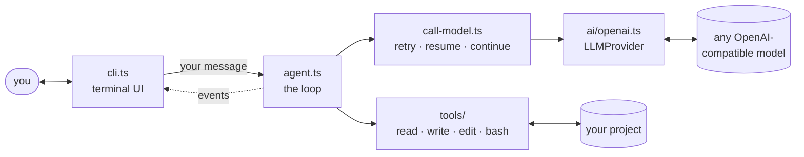

<div align="center">

# 🤖 agent-core

**A terminal coding agent built from scratch.**<br>
No LangChain. No agent SDKs. Just a loop, four tools, and a healthy fear of `rm -rf`.


<sub><i>the agent, mid-task</i></sub>

</div>

---

## ✨ What it does

Ask it something about your project. It reads files, runs commands, edits code and answers, deciding each step on its own.

```text
you> what version is in package.json? bump the patch number.

🔧 bash({"command":"ls -R","timeout":120}) → ✅ 5 lines
🔧 read({"path":"package.json","offset":1,"limit":200}) → ✅ 6 lines
🔧 edit({"path":"package.json","oldText":"  \"version\": \"0.1.0\",","newText":"  \"version\": \"0.1.1\","}) → ✅ 1 lines
The package version has been bumped from **0.1.0** to **0.1.1** in `package.json`.
[tokens: 4,191 in, 254 out]
```

- 🔁 **Streaming tool-calling loop**, written by hand
- 🛠️ **4 tools**, same as [Pi](https://github.com/badlogic/pi-mono): `read` · `write` · `edit` · `bash`
- 🔌 **Any OpenAI-compatible model**: OpenAI, Ollama (local or cloud), and more
- 🛡️ **Asks before running shell commands**, validates every tool input with zod
- 📄 **`AGENTS.md`** support for per-project instructions

## 🚀 Quick start

```bash
git clone https://github.com/javin1106/agent-core.git && cd agent-core
npm install
cp .env.example .env      # pick a model: Ollama works for free
npm run dev               # add "-- --yolo" to skip command approvals
```

<div align="center">


<sub><i>you, using <code>--yolo</code> in a repo you didn't write</i></sub>
</div>

## 🏗️ Architecture



The loop, in four lines:

```text
ask the model  →  it wants tools?  →  run them, add the results  →  repeat
                         ↓ no
                   final answer ✅
```

The agent only **emits events**; the CLI just **draws** them. Swapping in a TUI or a web UI means writing a new renderer, not touching the agent.

## 🧯 Built to survive


- **Retries** with exponential backoff (1s → 2s → 4s → 8s)
- **Dropped connection mid-reply?** It *resumes* the reply instead of restarting
- **Hit the length limit?** It asks for the rest automatically
- **Ctrl+C** stops the current task, not the app
- **Failed turn?** Finished tool steps are kept, so it never forgets a file it changed
- **Token + cost** tracking per turn and per session

<br clear="right"/>

## 📊 Benchmark

15 small coding tasks (create, edit, search, run), each in a fresh temp folder, checked automatically.

| Model | Pass rate | Model calls / task | Tokens / task | Time / task |
|---|---|---|---|---|
| `gpt-oss:120b` (Ollama Cloud) | **93%** (42/45, 3 runs) | ~3.1 | ~3.3K | ~2.9s |

## 🗺️ Roadmap

- [x] Agent loop, tools, zod validation, `AGENTS.md`
- [x] Retries, resume, auto-continue, Ctrl+C, cost tracking
- [ ] Context compaction + saved sessions (`--continue`)
- [ ] Eval suite in the repo (`npm run eval`)
- [ ] Publish to npm, then a proper TUI

<div align="center">
<sub>Built to learn how agents really work, one loop at a time.</sub>
</div>
